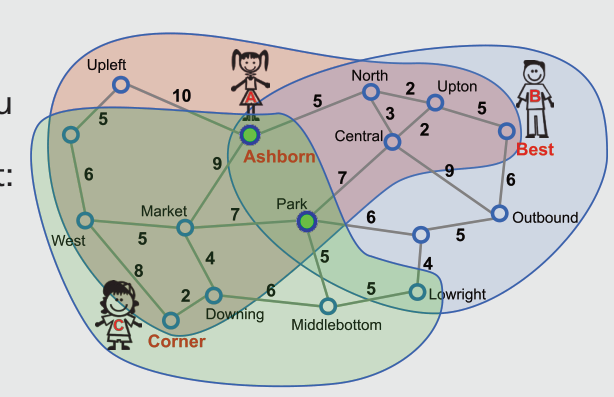

Park und Ashborn kommen als Treffpunkt in Frage. Zu diesen Haltestellen benötigen alle drei bei folgender Streckennutzung höchstens 15 Minuten reine Fahrzeit:

- Park: Ashborn–North–Central–Park: 15 Min.; Best–Upton–Central–Park: 14 Min.; Corner–Downing–Market–Park oder Corner–Downing–Middlebottom–Park: 13 Min. (Für den anscheinend direkteren Weg Ashborn–Market–Park würde Anne mehr Zeit benötigen als gewünscht, nämlich 16 Minuten.)
- Ashborn: Ashborn–Ashborn: 0 Min. (Anne muss hier also gar nicht fahren); Best–Upton–North–Ashborn: 12 Min.; Corner–Downing–Market–Ashborn: 15 Min.

Im Bild zeigen die farbigen Bereiche, welche Haltestellen Anne, Bernie bzw. Clara mit höchstens 15 Minuten reiner Fahrzeit erreichen können. Nur Ashborn und Park liegen im Schnitt der drei Bereiche. Es gibt also keine anderen möglichen Treffpunkte.

## Das ist Informatik!

Beziehungen zwischen Elementen nur einer Menge werden häufig zu „Graphen“ erweitert: Die Elemente heißen dann „Knoten“, und „Kanten“ sind Paare von Knoten, die miteinander in Beziehung stehen. In manchen Graphen haben die Kanten eine Richtung: Knoten a steht in Beziehung mit Knoten b, aber nicht umgekehrt. Kanten können auch bestimmte Werte als „Gewichte“ zugewiesen werden. Ein Verkehrsnetz kann sehr gut durch einen Graph modelliert werden, und zwar mit Kantengewichten, die der reinen Fahrzeit entsprechen.

Erfreulicherweise hat die Informatik viele leistungsfähige Algorithmen für Graphen entwickelt; zum Beispiel welche, die kürzeste Wege zwischen Knoten finden. „Kürzeste-Wege-Algorithmen“ wie der von Edsger W. Dijkstra bilden die Grundlage für Systeme zur Routenplanung, zum Beispiel Navigationssysteme für Autos.
