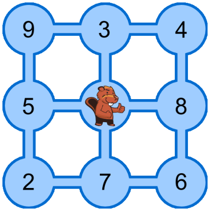

Im Bild siehst du neun Teiche. Sie sind durch Kanäle verbunden. Tobi Biber lebt im mittleren Teich, seine Freunde leben in den anderen Teichen. Die Zahlen zeigen an, wie viele Freunde in jedem Teich leben.

Tobi möchte seine Freunde besuchen. Er startet zuhause, schwimmt jeden Tag durch einen Kanal in einen anderen Teich, besucht dort seine Freunde und bleibt über Nacht. Am nächsten Tag schwimmt er weiter.

**Wie viele verschiedene Freunde kann Tobi innerhalb von vier Tagen höchstens besuchen?** Es ist ihm egal, in welchem Teich er nach den vier Tagen ankommt.
