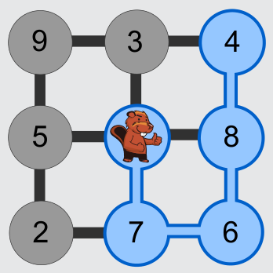

Antwort C ist richtig:

Tobi kann innerhalb von vier Tagen 25 Freunde besuchen. Der Weg (7-6-8-4), den er dazu nehmen muss, ist im Bild blau dargestellt.

Die Antworten A und B ergeben sich aus Schwimmrouten, auf denen Tobi zwar einzelne Teiche mit vielen Freunden, aber nicht insgesamt möglichst viele Freunde besucht. Antwort D ergibt sich, wenn die vier größten Freunde-Zahlen summiert werden, obwohl Tobi die zugehörigen Teiche nicht innerhalb von vier Tagen erreichen kann. Auch alle anderen Kombinationen von Teichen, in denen insgesamt mehr als 25 Freunde leben, kann Tobi nicht innerhalb von vier Tagen erreichen.

## Das ist Informatik!

Aus Sicht der Informatik bilden die Teiche und Kanäle einen Graph. Die Teiche sind die Knoten im Graph, die Freunde-Zahlen die Werte der Knoten, die Kanäle sind die Kanten im Graph.

Gesucht wird im Graph ein zusammenhängender Weg, der die Bedingungen erfüllt:

1. Tobis Teich ist der Startknoten. Sein Knotenwert ist 0.
2. Der Weg führt über höchstens 4 Kanten. Jeder Knoten kommt nur einmal vor.
3. Die Summe der Knotenwerte, die auf dem Weg liegen, ist so groß wie möglich.

In dem kleinen Graphen dieser Biber-Aufgabe lässt sich der gesuchte Weg mit Durchprobieren rasch finden. Für große Graphen mit vielen Kanten gebraucht die Informatik Methoden, eine gute Lösung zu finden, ohne die gigantisch vielen möglichen Wege alle durchprobieren zu müssen.
