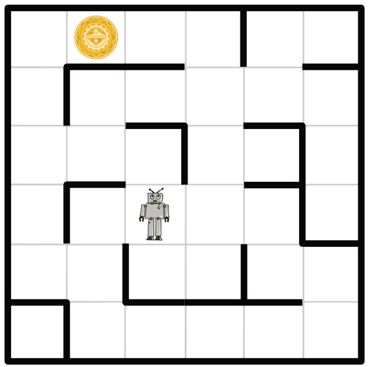

Raumfahrer sind auf einem verlassenen Planeten gelandet. Auf ihren Tele-Brillen sehen sie rätselhafte Bilder. Sie folgen den Signalen und machen als Quelle einen Roboter aus. Er steht in einem Labyrinth, das die Raumfahrer von ihrer erhöhten Position gut überblicken und sendet offensichtlich Nahaufnahmen seiner Umgebung.

Das Labyrinth ist in Quadrate eingeteilt. In einem davon befindet sich der Roboter. In einem anderen Quadrat befindet sich ein unbekanntes Objekt. Die Raumfahrer würden den Roboter gerne zum Objekt steuern, um Nahaufnahmen davon zu sehen.

Plötzlich flimmern vier kryptische Textzeilen mit insgesamt vier verschiedenen Wörtern über die Tele-Brillen. Auch der Roboter und das Objekt sind zu erkennen. Nach einigem Grübeln vermuten die Raumfahrer: Die vier Wörter sind Befehle, die den Roboter jeweils in ein benachbartes Quadrat steuern; für jede der vier möglichen Richtungen gibt es einen eigenen Befehl. Außerdem sind die Raumfahrer sicher, dass eine der Textzeilen eine Befehlsfolge ist, die den Roboter zum Objekt steuert.

**Welche der vier Textzeilen steuert den Roboter zum unbekannten Objekt?**
