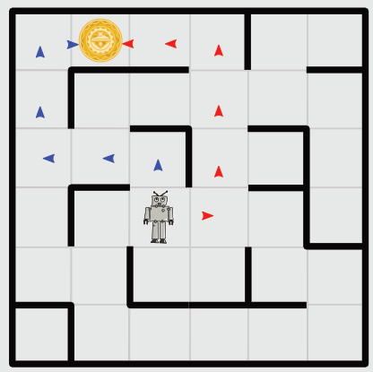

Antwort A ist richtig:

Keine der durch die Textzeilen gegebenen Befehlsfolgen enthält mehr als sechs Befehle. Mit jedem Befehl kann der Roboter einen Schritt in ein benachbartes Quadrat machen. Das Bild zeigt die beiden Wege, die den Roboter in sechs Schritten zum Objekt führen:

Die Befehlsfolge muss also den Roboter entweder so steuern (rote Pfeile): rechts, vor, vor, vor, links, links. Dazu passt keine der vier Textzeilen. Oder die Befehlsfolge muss den Roboter so steuern (blaue Pfeile): vor, links, links, vor, vor, rechts. Dazu passt nur Textzeile A mit Ha’ = vor, poS = links und nIH = rechts.

## Das ist Informatik!

Kryptoanalyse ist die Wissenschaft des Lesens verschlüsselter Botschaften. Seit der Antike versuchen Kryptoanalytiker geheime Nachrichten zu entschlüsseln. Dabei wird auch das Wissen über die mögliche Bedeutung der verschlüsselten Botschaften verwendet. Als im Zweiten Weltkrieg versucht wurde, die von der Enigma-Maschine verschlüsselten Botschaften zu entschlüsseln, suchte man gezielt nach deutschen Städtenamen und nach Wörtern, die in Wetterberichten vorkommen. Denn wichtige Nachrichten begannen oft mit einer Wettervorhersage. Bei dieser Biber-Aufgabe konntest du dich als Kryptoanalytikerin oder Kryptoanalytiker betätigen. Die Entschlüsselung ist übrigens wesentlich einfacher, wenn man klingonisch spricht. ;-)
