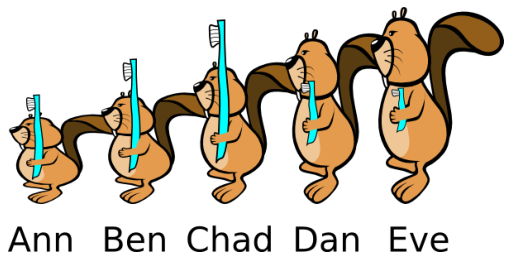

„Nicht so schnell!“ sagt Mutter Biber. „Eve und Chad, tauscht sofort die Zahnbürsten! Ann und Chad, danach tauscht ihr die Zahnbürsten!“

**Welche zwei Biber müssen noch ihre Zahnbürsten tauschen, so dass jeder die richtige Bürste hat?**
