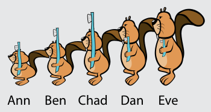
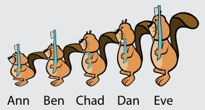
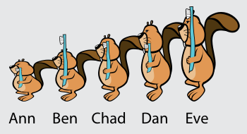

Antwort B ist richtig:

Anfangszustand:

„Eve und Chad, tauscht eure Zahnbürsten!“

„Ann und Chad, ihr beiden auch!“

Nun müssen nur noch Ben und Dan ihre Bürsten tauschen.

## Das ist Informatik!

Programmierer sind oft wie Mütter, die für Ordnung sorgen. Doch an Stelle von Zahnbürsten bewegen sie Zahlen in Speicherzellen des Computers. Das Vertauschen von Daten ist eine Grundoperation der Programmierung. Häufig muss eine Gruppe von Zahlenwerten nach der Größe sortiert werden. Die Zahlen sind in aufeinander folgenden Zellen gespeichert. Das Computerprogramm muss dafür sorgen, dass die kleinste Zahl in die erste Zelle kommt, die zweitkleinste in die zweite und so weiter, bis schließlich die größte Zahl in der letzten Zelle landet. Dieses Sortieren kann man bewerkstelligen, indem man mehrfach die Inhalte von Speicherzellen vertauscht.
