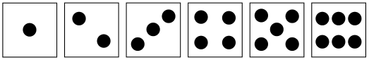
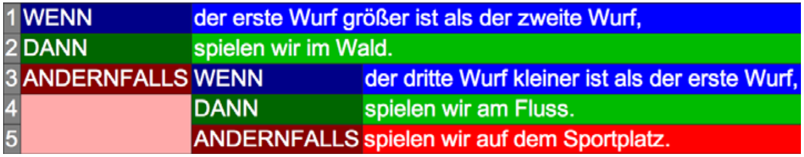

Nach der Schule gehen die jungen Biber gerne zusammen spielen. Damit es keinen Streit gibt, wohin sie zum Spielen gehen, wird gewürfelt. Der Würfel hat die Seiten 1 bis 6.

Die Entscheidung fällt nach dieser Regel:

**Welche Wurffolge wird die jungen Biber zum Sportplatz schicken?**
