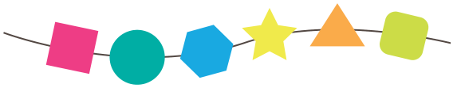

Leonie hat ein Armband aus verschiedenen Formen. Eines Tages reißt ihr Armband und lässt sich nicht mehr reparieren. Das gerissene Armband sieht so aus:

Leonie möchte genau so ein Armband wieder haben. Im Geschäft sieht sie vier verschiedene Armbänder.

**Welches ist genau so wie Leonies gerissenes Armband?**
