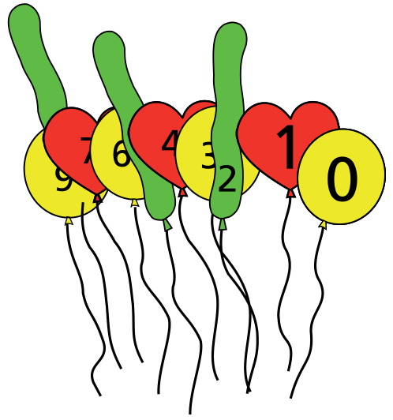

Im Ballongeschäft gibt es Ballons in drei unterschiedlichen Formen, auf denen Zahlen stehen:

0 – Kugel, 1 – Herz, 2 – Schlange, 3 – Kugel, 4 – Herz, und so weiter.

Toms Mutter hat Geburtstag. Sie wird 37 Jahre alt. Tom kauft zwei Ballons, die zusammen das Alter seiner Mutter anzeigen.

**Welche Formen haben die zwei Ballons?**
