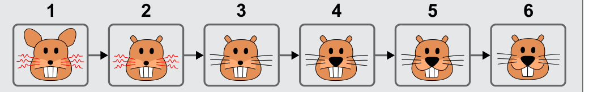

Die Biber-Bilder müssen so angeordnet sein: Von einem Bild zum nächsten ändert sich immer nur ein Merkmal.

- 1 → 2: Die Ohren werden kleiner.
- 2 → 3: Die Barthaare werden gerade-schwarz.
- 3 → 4: Die Nase wird größer.
- 4 → 5: Der Mund ändert sich zu einem Lächeln.
- 5 → 6: Die Anzahl der Zähne verringert sich von 3 auf 2.

## Das ist Informatik!

Die Biber-Bilder und auch die Unterschiede zwischen den Bildern lassen sich leicht beschreiben, denn die einzelnen Merkmale und deren Eigenschaften sind genau festgelegt: Barthaar: kraus-rot oder gerade-schwarz; Mund: neutral oder lächelnd; Nase: klein oder groß; Ohren: klein oder groß; Zähne: 2 oder 3.

Das Bild 1 in der Lösung lässt sich so beschreiben: Ohren: groß, Mund: neutral, Nase: klein, Zähne: 3, Barthaar: kraus-rot.

In den einzelnen Bildern eines computeranimierten Films kann es viele Objekte geben. Wenn deren Merkmale und Eigenschaften genau festgelegt sind, muss man nicht alle Bilder des Films speichern. Es genügt dann, die Unterschiede zwischen aufeinander folgenden Bildern mit Hilfe der Merkmale und Eigenschaften festzuhalten. Auch bei der Speicherung „echter“ Filme ist es geschickt, nur Unterschiede zwischen den Bildern festzuhalten. Es gibt dann aber keine dem Computer bekannten Objekte, Merkmale und Eigenschaften, sondern nur die einzelnen Pixel, in denen sich die Bilder unterscheiden. Das macht die Sache komplizierter.
