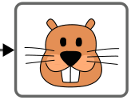

Aus sechs Biber-Bildern soll eine Animation entstehen. Dazu müssen die Bilder so angeordnet werden, dass sich von einem Bild zum nächsten nur ein Merkmal ändert: Barthaare, Mund, Nase, Ohren und Zähne. Das letzte Bild steht schon fest.

Das sechste und letzte Bild steht schon fest:

**Bringe die fünf Biber-Bilder A bis E in die richtige Reihenfolge, so dass sie zusammen mit dem letzten Bild eine Animation ergeben.**
