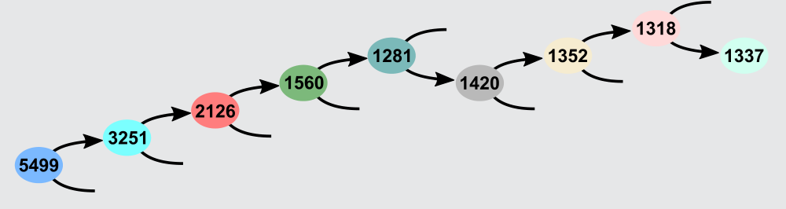

Bei der Vergabe der Nummern haben die Biber diese Regel befolgt: Um von einer Kammer aus eine Kammer mit niedrigerer Nummer zu finden, muss man den Gang nach links gehen, sonst nach rechts. Wenn man diese Regel erkannt hat, ist es nicht schwer, das gesuchte Zimmer zu finden. Von der Kammer mit Nummer 5499 aus verläuft der Weg zur Kammer 1337 so durch die Gänge wie im Bild gezeigt:

## Das ist Informatik!

Das haben die Biber gut gemacht: Auf der Suche nach einer bestimmten Kammer kann man sich immer sicher sein, ob man nach links oder rechts gehen muss. Und bei jeder Entscheidung zwischen rechts und links wird nicht nur eine Kammer von der weiteren Suche ausgeschlossen, sondern im besten Fall etwa die Hälfte aller Kammern. Lägen die Kammern alle an einem einzigen langen Gang statt an den vielen nach rechts und links verzweigenden Gängen, müsste man bei jeder einzelnen Kammer schauen, ob sie die richtige ist – und würde für die Suche viel länger benötigen.

In Computersystemen kann man Daten auf die gleiche schlaue Weise speichern. Die Informatik spricht dann von einem binären Suchbaum. Mit dessen Hilfe lässt sich z. B. aus einer Million Telefonnummern in etwa 20 Schritten die richtige finden. Damit das wirklich so gut klappt, müssen die Daten aber gut im Suchbaum verteilt sein. In der Informatik heißt das „balanciert“.
