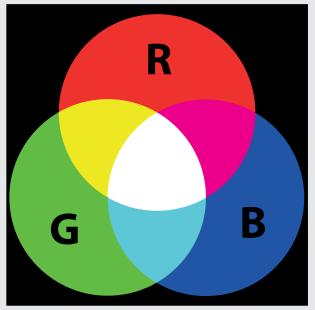

| | Minute 1 | Minute 2 | Minute 3 | Minute 4 |
|---|---|---|---|---|
| rotes Licht | aus | aus | an | an |
| grünes Licht | aus | an | aus | an |
| blaues Licht | an | an | an | an |
| Bühnenlicht | Blau | Cyan | Magenta | Weiß |

## Das ist Informatik!

Kameras und Bildschirme gibt es in jeder Form, Größe und Technologie. Um von der Technologie unabhängig Farbinformation in Programmen beschreiben zu können, benutzt die Informatik Farbmodelle. Es gibt viele Farbmodelle, und sie haben je nach Einsatzbereich gewisse Vorteile und Nachteile. Das Thema Farbe ist eine Wissenschaft für sich und reicht von philosophischen Farbtheorien bis zu den Zapfen im menschlichen Auge.

Ein in der Informatik viel gebrauchtes technisch-physikalisches Farbmodell ist RGB (red, green, blue). Durch additive Farbmischung von drei Grundfarben Rot, Grün und Blau werden weitere Farben beschrieben. Wie viele das sind, hängt davon ab, mit wie vielen Helligkeitsstufen man die Anteile der drei Grundfarben beschreibt. In dieser Biberaufgabe sind das nur die zwei Helligkeitsstufen AN (100%) und AUS (0%). Damit lassen sich, wie man im Bild sieht, 2 * 2 * 2 = 8 verschiedene Farben unterscheiden. Das ist sehr wenig. In der Praxis benutzt man meist ein Byte Information pro Grundfarbe, also 256 Helligkeitsstufen. Damit lassen sich 256 * 256 * 256 = 16.777.216 verschiedene Farben unterscheiden.

