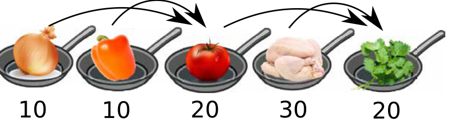

Ilia kocht am liebsten Chakhokhbili, ein traditionelles georgisches Huhngericht. Die folgenden Schritte sind dazu nötig. Es ist angegeben, wie viel Zeit jeder Schritt dauert.

| | Schritt | Dauer |
|---|---|---|
| 1 | Dünste eine Zwiebel. | 10 Minuten |
| 2 | Dünste eine Paprika. | 10 Minuten |
| 3 | Koche die Ergebnisse der Schritte 1 und 2 zusammen mit einer Tomate. | 20 Minuten |
| 4 | Koche das Huhn. | 30 Minuten |
| 5 | Koche die Ergebnisse der Schritte 3 und 4 zusammen mit einigen Gewürzen. | 20 Minuten |

Wenn Ilia im Garten kocht, benutzt er einen Einzelbrenner. Er muss deshalb die Schritte nacheinander ausführen. Er benötigt dann insgesamt 90 Minuten, um sein Chakhokhbili zu kochen.

Im Haus kocht Ilia auf einem Herd mit sechs Brennern. Er kann dadurch manche Schritte gleichzeitig ausführen und so weniger Zeit benötigen.

**Wie viele Minuten benötigt Ilia mindestens, um im Haus sein Chakhokhbili zu kochen?**
