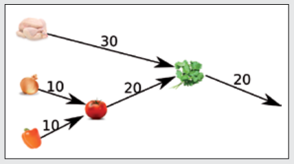
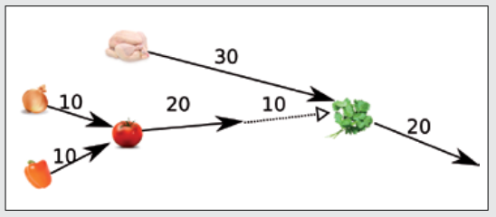

50 ist richtig:

Mit 2 Brennern (linkes Bild) benötigt Ilia mindestens 60 Minuten. Mit 3 Brennern (rechtes Bild) benötigt Ilia mindestens 50 Minuten.

Schneller geht es nicht: Schritte 4 und 5 müssen hintereinander ausgeführt werden. Allein für diese Schritte benötigt Ilia schon 50 Minuten.

## Das ist Informatik!

Hat ein Computer nur einen Prozessor, so können alle Rechenschritte nur hintereinander (sequentiell) ausgeführt werden. Sind hingegen mehrere Prozessoren vorhanden, dann können voneinander unabhängige Rechenschritte auf mehrere Prozessoren aufgeteilt und parallel durchgeführt werden. Parallel Computing ist ein großes Feld der Forschung in der Informatik. Es hat sich bewährt, Programm-Code so zu verfassen, dass er auf möglichst viele Prozessoren aufgeteilt werden kann und so möglichst schnell ausgeführt wird.

Die Zuteilung an die Prozessoren sollte so geschehen, dass Programmteile möglichst wenig auf die Zwischenergebnisse anderer Programmteile warten müssen. Die Informatik arbeitet an immer besseren Algorithmen für das sogenannte „job scheduling“.
