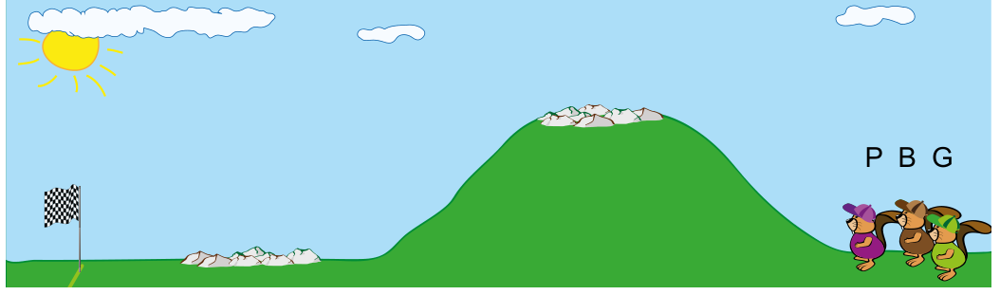

Drei entschlossene Biber treten zum Cross-Country-Lauf an.

- **P:** Jedesmal wenn es bergab geht, überholt Mrs. Pink (P) genau einen Biber.
- **B:** Jedesmal wenn es bergauf geht, überholt Mr. Brown (B) genau einen Biber.
- **G:** Jedesmal wenn es über Felsen geht, überholt Mrs. Green (G) genau einen Biber.

Im Bild sieht man, dass die Strecke erst bergauf führt, dann folgen Felsen. Danach geht es bergab, und schließlich folgen wieder Felsen.

Zuerst startet Mrs. Pink, als nächstes Mr. Brown und zuletzt Mrs. Green.

**In welcher Reihenfolge laufen die Biber ins Ziel ein?**
