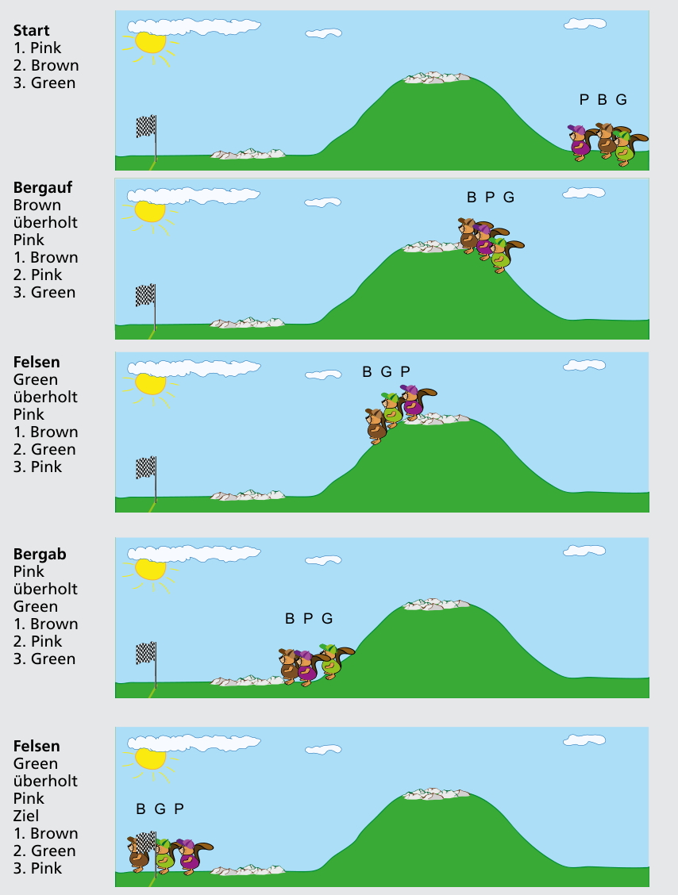

Antwort B ist richtig:

| Abschnitt | Was passiert | Reihenfolge |
|---|---|---|
| Start | | 1. Pink, 2. Brown, 3. Green |
| Bergauf | Brown überholt Pink | 1. Brown, 2. Pink, 3. Green |
| Felsen | Green überholt Pink | 1. Brown, 2. Green, 3. Pink |
| Bergab | Pink überholt Green | 1. Brown, 2. Pink, 3. Green |
| Felsen | Green überholt Pink | 1. Brown, 2. Green, 3. Pink |

Im Ziel sind die Biber also in der Reihenfolge Mr. Brown, Mrs. Green, Mrs. Pink.

## Das ist Informatik!

Ein Programmierer muss genau wissen, wie sein Programm funktioniert. Besonders wenn ein Fehler auftritt, spielt er das Programm Schritt für Schritt durch, um nachzuvollziehen, wie jede einzelne Operation sich auswirkt. Das nennt man Debugging. Um herauszufinden, in welcher Reihenfolge die Biber ins Ziel einlaufen, muss man das Cross-Country-Rennen ebenfalls Schritt für Schritt durchspielen, wie beim Debugging.
