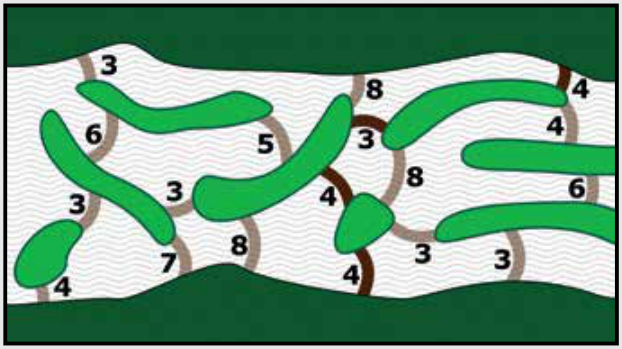

Wenn die Biber die Dämme genau an den im Plan dunkler markierten Stellen bauen, brauchen sie 4 + 3 + 4 + 4 = 15 Baumstämme. Es gibt noch eine zweite Lösung mit 4 + 3 + 8 = 15 Baumstämmen. Bauen die Biber Dämme an anderen Stellen, brauchen sie mehr Baumstämme, oder es bleibt eine Lücke, durch die noch Wasser fließen kann.

## Das ist Informatik!

Die Aufgabe, den Fluss mit möglichst wenig Baumstämmen aufzustauen, kann auch anders formuliert werden. Die Anzahl der Baumstämme, die zum Dammbau an einer Stelle gebraucht werden, kann als „Länge“ dieser Stelle verstanden werden. Dann haben die Biber die Aufgabe, den kürzesten Weg von einem Ufer zum anderen entlang der Dammbaustellen zu finden.

Einen Algorithmus zum Finden eines kürzesten Weges hat der Informatiker Edsger W. Dijkstra im Jahr 1959 bereits gefunden. Auf diesen Algorithmus können die Biber also zurückgreifen, um zu bestimmen, wie sie den Fluss mit möglichst wenigen Baumstämmen aufstauen können.

In der Informatik (und nicht nur da) ist es sehr nützlich, eine Aufgabe so umzudeuten, dass man zu ihrer Erledigung auf bekannte Lösungen zurückgreifen kann. Es ist ein wichtiger Teil der Informatik-Ausbildung, dieses Umdeuten zu lernen. Dass Informatikerinnen und Informatiker damit zur Bequemlichkeit erzogen werden, ist selbstverständlich nur eine missgünstige Behauptung.
