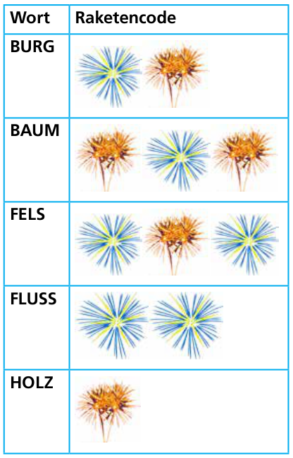
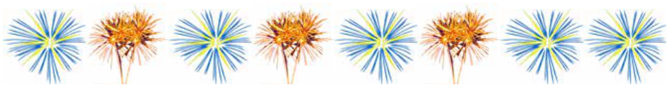

Zwei befreundete Biber leben in ihren Burgen durch einen großen Wald getrennt. Sie senden sich abends Nachrichten, indem sie Feuerwerksraketen nacheinander in den Himmel schießen. Jede Nachricht ist eine Reihe von Wörtern. Jedes Wort ist durch eine Abfolge von Raketen codiert. Sie benutzen nur fünf verschiedene Wörter (siehe Tabelle).

Für die Nachricht „HOLZ BURG HOLZ“ würde zum Beispiel dieses Feuerwerk in den Himmel geschossen:

Leider ist der Raketencode nicht eindeutig. Das Feuerwerk könnte auch die Bedeutung „BAUM HOLZ“ haben.

**Wie viele verschiedene Bedeutungen könnte dieses Feuerwerk haben?**
