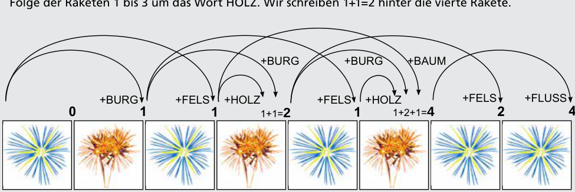

4 ist richtig. Die Nachricht kann diese Bedeutungen haben:

- BURG FELS HOLZ FLUSS
- BURG BURG BURG FLUSS
- FELS BAUM FLUSS
- FELS HOLZ BURG FLUSS

Um uns zu überzeugen, dass es keine weiteren Bedeutungen gibt, probieren wir systematisch durch, wie im Bild gezeigt:

- Wir beginnen mit der ersten Rakete. Sie allein hat keine Bedeutung. Wir schreiben eine 0 hinter die Rakete.
- Die ersten zwei Raketen können nur BURG bedeuten. Wir schreiben eine 1 hinter die zweite Rakete.
- Die dritte Rakete könnte die Bedeutung der bisherigen Raketenfolge, gefolgt von einem neuen Wort haben. Das ist aber nicht der Fall, so ergibt sich bis jetzt nur als einzige Bedeutung FELS. Wir schreiben eine 1 hinter die dritte Rakete.
- Die vierte Rakete kann die Folge der Raketen 1 bis 2 um das Wort BURG verlängern, aber auch die Folge der Raketen 1 bis 3 um das Wort HOLZ. Wir schreiben 1+1=2 hinter die vierte Rakete.

Wir verwenden dasselbe Verfahren nach jeder rechts folgenden Rakete. Dabei schauen wir bis zu drei Raketen zurück. Nach der letzten Rakete haben wir die Anzahl aller möglichen Bedeutungen ermittelt.

Die hier verwendete Methode, eine Lösung systematisch Schritt für Schritt zu konstruieren und dazu die Lösungen der vorherigen Schritte zu benutzen, heißt in der Informatik „Dynamische Programmierung“.

## Das ist Informatik!

Die meisten in der Informatik üblichen Codes benutzen für alle Wörter, aus denen sie Nachrichten zusammenstellen, eine gleiche Anzahl Bits. Das hat den Vorteil, dass es bei der Ermittlung der Bedeutung der Nachrichten keine Mehrdeutigkeiten geben kann.

In diesen beiden Biberaufgaben sind die zwei Sorten Feuerwerksraketen die Bits 0 und 1. Um fünf Wörter voneinander zu unterscheiden, bräuchten die befreundeten Biber bei gleicher Wortlänge immer drei Raketen pro Wort.

Vielleicht benutzen sie aber das Wort HOLZ sehr häufig, die Wörter BURG und FLUSS seltener und die Wörter BAUM und FELS sehr selten. So haben sie sich einen dazu passenden Raketencode ausgedacht, mit dem sie eine Menge Raketen einsparen können. Clever.

Noch cleverer wäre es allerdings, wenn sie sich einen Präfixcode ausgedacht hätten. Dann gäbe es keine mehrdeutigen Nachrichten und trotzdem eine gewisse Raketen-Sparsamkeit. Ein Beispiel wäre: HOLZ = 01, BURG = 10, FLUSS = 11, BAUM = 000, FELS = 001.
