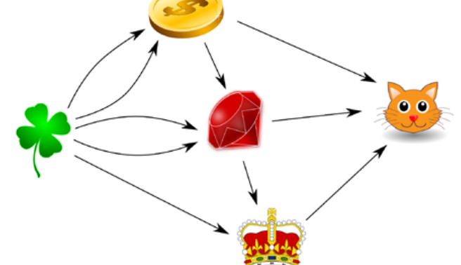

Der Magier kann Dinge verwandeln. Bei jeder Verwandlung verschwinden ein oder mehrere Dinge und etwas Neues wird erschaffen. Der Magier beherrscht vier Verwandlungen:

- Aus zwei Kleeblättern wird eine Münze erschaffen.
- Aus einer Münze und zwei Kleeblättern wird ein Edelstein erschaffen.
- Aus einem Edelstein und einem Kleeblatt wird eine Krone erschaffen.
- Aus einer Münze, einem Edelstein und einer Krone wird ein Kätzchen erschaffen.

**Wie viele Kleeblätter verbraucht der Magier, um ein Kätzchen zu erschaffen?**
