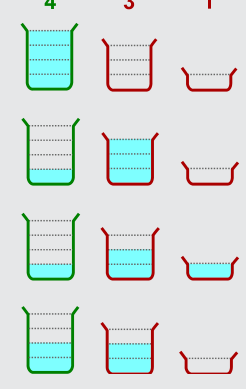
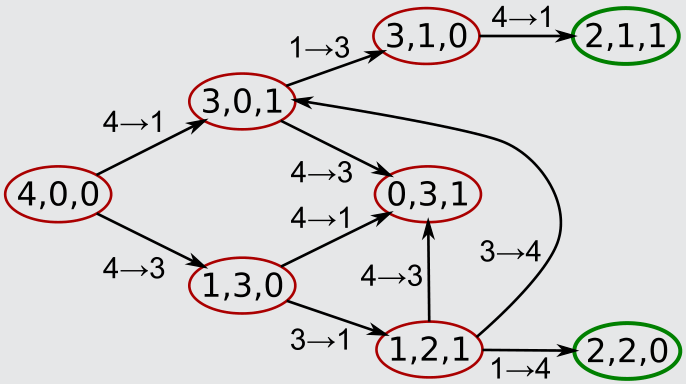

Es gibt zwei kürzeste Schüttungsfolgen, die dafür sorgen, dass beide am Ende gleich viel Wasser haben: 4 → 3, 3 → 1, 1 → 4 (s. Bild) und 4 → 1, 1 → 3, 4 → 1.

Das folgende Bild zeigt alle Möglichkeiten, vom Anfangszustand aus (kurz: 4,0,0) Wasser von einem Gefäß in ein anderes zu schütten.

Man kann zwei Dinge erkennen: Mit nur zwei Schüttungen kann man zu den Zuständen 3,1,0 bzw. 0,3,1 bzw. 1,2,1 kommen; das sind aber keine fairen Verteilungen. Vom Zustand 0,3,1 aus könnte man nur zurückschütten und kommt nicht weiter. Es gibt keine anderen Schüttungsfolgen mit nur drei Schüttungen, die zu einer der fairen Verteilungen 2,2,0 und 2,1,1 führen.

## Das ist Informatik!

Um dieses Problem zu lösen, muss man Schüttungen auf zwei Objekte anwenden: Das Gefäß, aus dem geschüttet wird, sowie das Gefäß, in das geschüttet wird.

Eine Schüttung kann den Inhalt dieser beiden Gefäße verändern. In der Informatik wird das als Prozedur mit Seiteneffekt bezeichnet. Jedoch ist der Effekt klar, den eine Schüttung auf das dritte Gefäß hat: keinen. Eine Schüttung hat also keinen versteckten Seiteneffekt, sondern wirkt sich nur auf die Objekte aus, auf die es angewandt wird.

Versteckte Seiteneffekte machen Programme kompliziert und sollten vermieden werden. In manchen Programmiersprachen, in denen Operationen (wie die Schüttung) als Funktionen behandelt werden, die einen Wert berechnen, ist es guter Stil, Seiteneffekte komplett zu vermeiden. In der realen Welt können Seiteneffekte aber auch erwünscht sein: Mit Schüttungen ohne Seiteneffekte bekäme Kazim kein Wasser.
