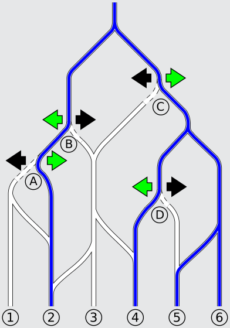

Die Schleusen müssen so stehen: A rechts, B links, C rechts und D links. Im Heft sind die Schleusen am Anfang so eingestellt, dass die Felder 1, 2, 5 und 6 bewässert werden; ein Klicken auf die Pfeile der Schleusen A und D stellt die gewünschte Bewässerung her.

## Das ist Informatik!

Das Bewässerungssystem verhält sich wie ein gerichteter Graph. Ein gerichteter Graph verbindet Knoten (in diesem Fall die Verzweigungen der Kanäle) durch Kanten (in diesem Fall Kanäle), die eine bestimmte Richtung haben (in diesem Fall die Fließrichtung des Wassers von oben nach unten). Durch das Lenken des Wassers wird festgelegt, ob bestimmte Kanten im Graphen vorhanden sind oder nicht. Um festzustellen, welche Felder alle bewässert werden, muss nun der Graph von der Wurzel (in diesem Fall der See) aus entlang aller möglicher Kanten durchlaufen werden. Damit werden alle möglichen Wege im Graphen durchlaufen und alle erreichbaren Knoten markiert. Der Algorithmus, mit dem dies häufig überprüft wird, heißt passenderweise Flutfüllung respektive Floodfill.
