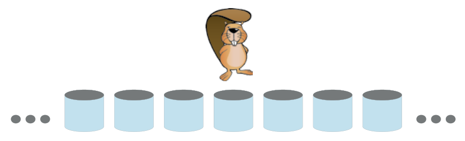

Biber Gump ist sehr fleißig. Biber Alan hat ihn darum angestellt, eine Reihe von Behältern mit Vorräten zu füllen. Jeder Behälter kann entweder „leer“ oder „voll“ sein. Anfangs sind alle Behälter „leer“, und Gump steht vor einem von ihnen.

Alan hat Gump angewiesen, auf welche Weise er die Behälter füllen soll. Welche Anweisung er jeweils ausführt, hängt erstens davon ab, ob der Behälter, vor dem er steht, „leer“ oder „voll“ ist. Und zweitens von Gumps Stimmung – die ist entweder „easy“ oder „cool“.

Eine Anweisung sagt Gump, sich zum nächsten Behälter „links“ oder „rechts“ zu bewegen und „easy“ oder „cool“ zu sein – oder mit der Arbeit zu „STOPPEN“.

Wenn Gump weiß, was er zu tun hat, schaut er sich noch den Behälter an, vor dem er steht. Ist der „leer“, macht er ihn „voll“, bevor er sich gemäß der Anweisung bewegt.

Alan hat die Anweisungen in eine Tabelle geschrieben:

| | easy | cool |
|---|---|---|
| **leer** | (rechts, cool) | (links, easy) |
| **voll** | (links, cool) | STOPPEN |

Gump startet in der Stimmung „easy“.

**Wie viele Behälter sind „voll“, wenn Gump STOPPT?**
