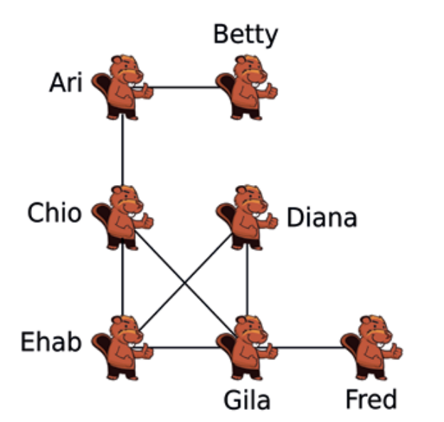

Sieben Biber haben sich in einem Online-Netzwerk registriert. Das Bild zeigt, welche Biber in diesem Netzwerk „Freunde“ sind: Freunde sind mit einer Linie verbunden.

Nach den Sommerferien teilt jeder Biber ein Ferienfoto von sich mit seinen Freunden im Netzwerk. So erscheint das Foto auf den Seiten der Freunde.

Jeder Biber sieht die Fotos auf seiner eigenen Seite und die Fotos auf den Seiten seiner Freunde.

**Wessen Ferienfoto können die meisten anderen Biber sehen?**
