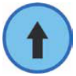

Du hast einen Spielzeugroboter mit zwei Knöpfen. Das passiert, wenn du die Knöpfe drückst:

 Der Roboter fährt ein Stück nach vorne.

 Der Roboter dreht sich auf der Stelle um ein Viertel nach rechts.

**Wie musst du die Knöpfe drücken, damit der Roboter am Ende um ein Viertel nach links gedreht ist?**
