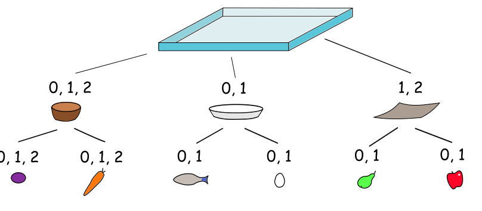

Hm, was soll es zum Mittagessen geben? In der Cafeteria hängt ein Poster über ausgewogene Biber-Ernährung. Das Diagramm darauf zeigt, wie man sein Tablett belädt.

Es gibt drei Arten von Schüsseln. Die Zahlen zeigen an, wie viele Schüsseln einer Art man auf das Tablett stellen soll. Für jede Schüssel gibt es zwei Arten von Lebensmitteln. Die Zahlen zeigen an, wie viele davon man in die Schüssel legen soll.

**Welche der folgenden Mahlzeiten passt NICHT zu dem Diagramm?**
