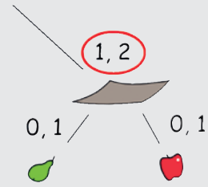

Antwort D ist richtig: Die Mahlzeit D wurde nicht nach dem Diagramm zusammengestellt. Sie enthält keine Schüssel der dritten Art. Die dritte Schüsselart ist aber mit den Zahlen 1 und 2 beschriftet, das heißt, man soll eine oder zwei davon auf das Tablett stellen.

## Das ist Informatik!

Das Diagramm hat die Form eines umgedrehten Baumes. Deshalb nennt die Informatik solche Diagramme „Baum“. An der Wurzel ist das Tablett, an den Ästen sind die Schüsseln und die Lebensmittel. In der Informatik finden Bäume sehr viele unterschiedliche Anwendungen. So gibt es Entscheidungsbäume, in denen verzweigte Entscheidungsregeln dargestellt werden, um z. B. den Bustarif abhängig von der Fahrstrecke, Tageszeit und vom Fahrgastalter zu ermitteln. Es gibt auch spezielle Spielbäume, um die möglichen Spielzüge z. B. beim Schach darzustellen. In dieser Biberaufgabe wird mit Hilfe eines Baums übersichtlich dargestellt, wie ein komplexes Objekt aus einfacheren Bestandteilen zusammengesetzt werden soll.
