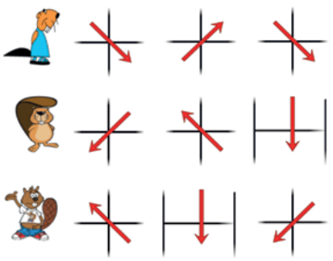

Drei Biber stehen im Wald. Jeder will zu einer Stelle kommen, wo es Pilze gibt.

Dieses Bild zeigt für jeden Biber mit drei Pfeilen, wie er gehen wird. Jeder Pfeil bedeutet einen Schritt auf das nächste Feld in diese Richtung.

**Wo kommen die Biber an?** Ziehe jeden Biber zu der richtigen Stelle im Wald. Biber 1 steht in Zeile 1, Spalte 2, Biber 2 in Zeile 4, Spalte 5 und Biber 3 in Zeile 3, Spalte 3. Pilze gibt es in Zeile 2 Spalte 1, Zeile 2 Spalte 5, Zeile 3 Spalte 4, Zeile 4 Spalte 1 und Zeile 5 Spalte 3.
