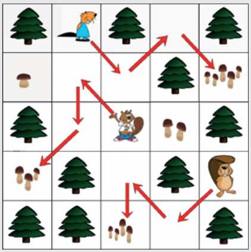

So kommen die Biber an:

- Biber 1 kommt in Zeile 2, Spalte 5 an.
- Biber 2 kommt in Zeile 5, Spalte 3 an.
- Biber 3 kommt in Zeile 4, Spalte 1 an.

## Das ist Informatik!

In der Informatik gibt es verschiedene Programmiersprachen. Darunter sind traditionell solche, in denen man Handlungsanweisungen mit formelhaften Texten beschreibt.

Es sind aber auch Programmiersprachen möglich, wo die Handlungsanweisungen mit grafischen Symbolen beschrieben werden. Wichtig ist nur, dass immer klar ist, was mit jedem grafischen Symbol gemeint ist – was seine Bedeutung ist. Sonst handelt die programmierte Maschine nicht so, wie das Programm gemeint war.

Bei dieser Biberaufgabe kann man die Bedeutungen der grafischen Symbole – der Pfeile – leicht herausfinden: „gehe zur nächsten Stelle rechts unten“, „gehe zur nächsten Stelle links oben“, „gehe zur nächsten Stelle unten“ usw.
