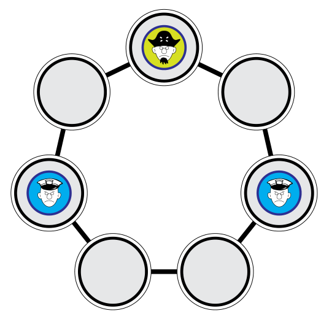

Das Spiel „Piratenjagd“ geht so: „Polizei“ und „Pirat“ ziehen abwechselnd. Ist die Polizei am Zug, muss sich einer der Polizisten auf ein benachbartes, freies Feld bewegen. Der Pirat bewegt sich in einem Zug immer um zwei Felder weiter. Das Spiel ist zu Ende, wenn der Pirat gezwungen ist, sich auf ein Feld zu bewegen, dass von einem Polizisten besetzt ist.

Wenn der Pirat am Zug ist und das Spiel in der abgebildeten Situation ist, hat der Pirat also verloren – und die Polizei hat gewonnen. Die Polizei versucht also, den Piraten in diese Position zu zwingen.

Das Spiel beginnt in der abgebildeten Situation – aber die Polizei ist am Zug.

**Wenn der Pirat keine Fehler macht, hat dann die Polizei eine Chance zu gewinnen? Wenn ja, nach wie vielen Zügen?** Du kannst selbst Züge machen, um die Möglichkeiten zu probieren.
