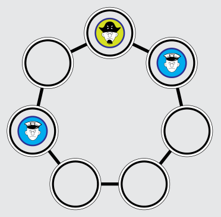
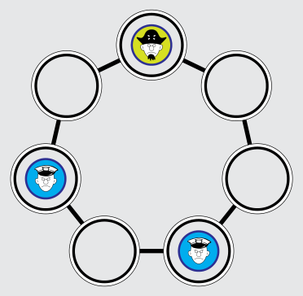
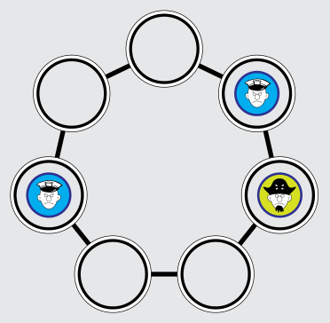
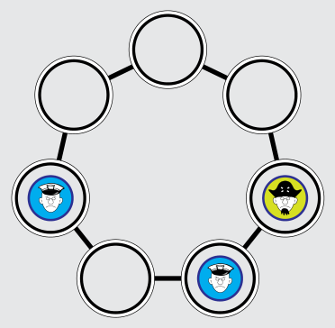

Antwort D ist richtig: Die Polizei hat keine Chance zu gewinnen.

Nehmen wir an, das Spiel ist in der gezeigten Situation, und der Pirat ist am Zug – dann gewinnt die Polizei. Mit welchem Zug hat die Polizei den Piraten in diese (aus ihrer Sicht) Gewinnsituation gezwungen? Einer der Polizisten muss sich um ein Feld bewegt haben, nach oben oder unten. Nehmen wir an, es war der rechte Polizist; weil das Spielfeld symmetrisch ist, ist das keine Einschränkung. Vor dem Zug war das Spiel dann in einer der folgenden Situationen:

 

Welchen Zug kann der Pirat wiederum davor gemacht haben? Er muss von rechts gekommen sein (links steht ein Polizist). Also war das Spiel vor seinem Zug in einer dieser Situationen:

 

Nur aus einer dieser Situationen (oder einer der „gespiegelten“ Situationen, die entstehen, falls in der vorletzten Situation der linke Polizist gezogen ist) kann es also zur Gewinnsituation der Polizei kommen. Weil der Pirat aber keine Fehler macht, wird er sich in diesen Situationen nicht nach oben bewegen, sondern nach links. Es kann also auch nicht zur Gewinnsituation kommen, und die Polizei hat keine Chance zu gewinnen.

## Das ist Informatik!

Es gibt sehr viele Spiele mit zwei Spielern, z. B. Schach oder Dame. Viele dieser Spiele kann man auch gegen den Computer spielen. Programme für diese Spiele berechnen ihre eigenen Züge, indem sie von der aktuellen Situation ausgehen und die möglichen Züge berechnen, die sie selbst und ihr Gegner in der Folge machen können. Mit Hilfe von Algorithmen wie Minimax bewerten sie ihre eigenen Züge und nehmen dabei an, dass der Gegner keinen Fehler macht – wie hier der Pirat. Sind die Spiele sehr kompliziert (wie etwa Schach), können nicht alle Züge vorausberechnet werden; dann muss sich das Programm bei der Bewertung der eigenen Zugmöglichkeiten mit Abschätzungen helfen. Bei einigen Zwei-Personen-Spielen sind Programme besser als alle Menschen, z. B. im Schach, während bei anderen solchen Spielen wie etwa Go Menschen (noch) überlegen sind.
