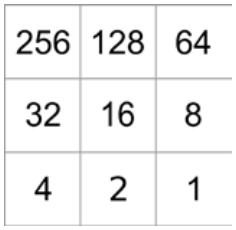
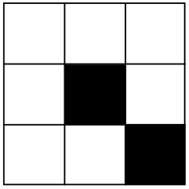

Die Biber stellen Zahlen als Bilder dar, und zwar mit dem „Quick Beaver Code“, kurz: QB-Code. Ein QB-Code ist ein Bild mit 3 mal 3 Feldern, die schwarz oder weiß sein können.

Wenn ein Feld schwarz ist, hat es einen Wert. Das Bild zeigt die Werte für die schwarzen Felder:

Den Gesamtwert eines QB-Codes bekommt man heraus, indem man die Werte der schwarzen Felder addiert.

Zum Beispiel hat dieser QB-Code den Gesamtwert 16 + 1 = 17.

Die Biber müssen aber aufpassen, wenn sie einen QB-Code drehen. Dann könnte er nämlich einen anderen Gesamtwert bekommen.

Im Raster unten siehst du einen QB-Code mit den schwarzen Feldern oben Mitte, Mitte links und unten rechts.

**Drehe diesen QB-Code so, dass sein Gesamtwert am größten wird.** Male dazu den gedrehten QB-Code in das Raster.
