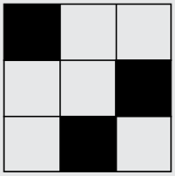

Der QB-Code muss so gedreht werden, dass das Feld links oben schwarz ist:

Hast du entdeckt, dass man die richtige Antwort auch ohne Rechnen bestimmen kann? Der Wert, den ein schwarzes Feld haben kann, ist nämlich um 1 größer als die Summe aller kleineren möglichen Werte. Z. B. ist 4, der Wert links unten, um 1 größer als 2 + 1 = 3. Und 256, der Wert links oben, ist um 1 größer als 128 + 64 + 32 + 16 + 8 + 4 + 2 + 1 = 255. Also wird der Gesamtwert des QB-Codes am größten, wenn er so gedreht wird, dass das Feld links oben schwarz ist.

## Das ist Informatik!

Der QB-Code ist eine grafische Codierung von Zahlen. Das System des QB-Codes entspricht dem binären Zahlensystem: Jedes Feld ist eine Stelle. Ist ein Feld weiß, steht an dieser Stelle in der binären Zahl eine 0, ist es schwarz, steht dort eine 1.

Das Drehen eines QB-Codes verändert seinen Wert. Deshalb ist das System des QB-Codes unzuverlässig. Besser sind da die QR-Codes (kurz für: Quick Response Codes), die ebenfalls aus weißen und schwarzen Feldern bestehen. Sie werden zu verschiedenen Zwecken eingesetzt: zur Codierung einer Artikelnummer, einer Adresse, einer URL, einer Visitenkarte, einer Telefonnummer, usw. Mit einem Smartphone kann der QR-Code gescannt und entschlüsselt werden. Beim QR-Code kann man rasch und einfach erkennen, wo oben und unten ist. Das wird durch die auffälligen schwarzen Quadrate in der linken unteren, linken oberen und rechten oberen Ecke erreicht. Auch wenn beim Scannen des QR-Codes das Smartphone gedreht wird, kann der Wert des QR-Codes eindeutig entschlüsselt werden.
