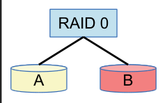
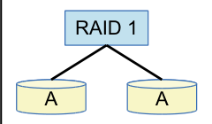

RAID ist eine Technologie, die mehrere Festplatten zu einem gemeinsam organisierten Datenspeicher bündelt. Es gibt unter anderem diese zwei RAID-Typen:

**RAID 0:** Die Daten werden nur auf einer im RAID angeschlossenen Festplatte gespeichert. Die Inhalte der Festplatten sind alle verschieden. Deshalb ist die Datensicherheit nicht höher als bei einer einzelnen Festplatte. Dieses Bild zeigt einen RAID 0 mit zwei Festplatten:

**RAID 1:** Die Daten werden auf mehreren Festplatten so abgespeichert, dass die Inhalte dieser Festplatten immer gleich sind. Die Speicherkapazität ist dann zwar nicht so hoch. Dafür ist die Datensicherheit umso höher, je mehr Kopien im RAID gespeichert sind. Dieses Bild zeigt einen RAID 1 mit zwei Festplatten:

**Bei welchem dieser RAIDs gibt es KEINEN Datenverlust, auch wenn zwei beliebige seiner Festplatten kaputt gehen?**
