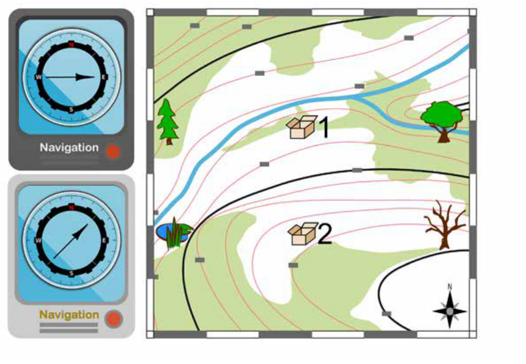

Anna und Bob sind auf der Suche nach zwei Kisten, die für sie versteckt wurden. Dabei benutzen sie zwei Navigationsgeräte. Ein Gerät zeigt die Richtung zu Kiste 1, das andere die Richtung zu Kiste 2. Leider weißt du nicht, welches Gerät zu welcher Kiste zeigt.

Im Bild siehst du links, welche Richtungen die beiden Geräte gerade zeigen. Auf der Landkarte rechts siehst du sechs Orte. Darunter sind die Stellen, wo die Kisten versteckt sind.

**An welchem Ort sind Anna und Bob gerade?**
