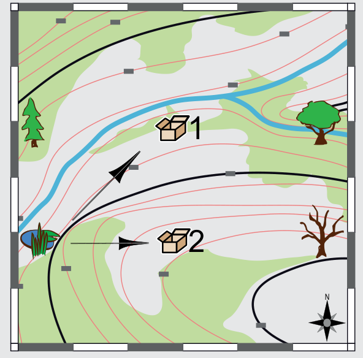

Antwort C ist richtig: Anna und Bob sind am Teich. Nur an diesem Ort stimmen die Richtungen zu den Kisten, die von den Geräten angezeigt werden (siehe Bild).

An der Fichte können Anna und Bob nicht sein. Ein Gerät zeigt nämlich nach Nordosten, aber von der Fichte aus nach Nordosten ist keine Kiste versteckt.

An der Ulme können Anna und Bob nicht sein; die Geräte müssten sonst nach Westen und Südwesten zeigen.

An der Kiste 1 können sie auch nicht sein. Wir wissen zwar nicht, wohin ein Gerät zeigt, wenn man die passende Kiste erreicht hat. Aber das Gerät, das die Richtung zu Kiste 2 zeigt, müsste von Kiste 1 aus nach Süden zeigen.

## Das ist Informatik!

Anna und Bob machen Geocaching, ein Spiel, bei dem die geographischen Positionen von versteckten „Schätzen“ bekannt sind. Um einen Schatz zu finden, gibt man die Position in Geräte ein, die das „Global Positioning System“ (GPS) beherrschen, z. B. Smartphones oder spezielle GPS-Navigationsgeräte. Mit Hilfe von GPS können die für diese Geräte geschriebenen Programme die Position des Geräts bestimmen und die Richtung zu einer anderen Position zeigen.

GPS wird auch von Navigationssystemen in Autos benutzt, außerdem in der Landwirtschaft, in der Seefahrt, beim Sport usw. Moderne Smartphones können für die Positionsbestimmung zusätzlich zu GPS noch ihre Telefon- und ihre WLAN-Verbindung nutzen.
