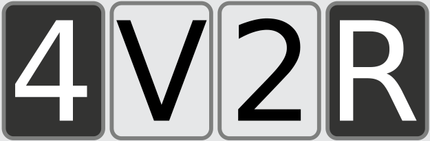

Du musst die Karten E und 7 umdrehen.

Hinter dem E muss eine gerade Zahl stehen, sonst hat Aristo gelogen. Hinter der 7 darf kein Vokal stehen, denn sonst stünde bei einem Vokal eine ungerade Zahl. Das V und die 2 müssen nicht umgedreht werden: Aristos Behauptung sagt nichts darüber, was hinter einem Konsonanten oder hinter einer geraden Zahl steht.

## Das ist Informatik!

Es ist gar nicht schwer, einen Computer denken zu lassen. Vor allem wenn es um das Denken in klassisch-logischen Implikationen geht. Fast jede Programmiersprache bietet dazu als Basis das Konstrukt (IF a THEN b) an. In einigen Programmiersprachen kann man sogar einen weit verbreiteten menschlichen logischen Denkfehler programmieren:

(IF (IF a THEN b) THEN (IF b THEN a)) ist unlogisch und nicht wahr!
