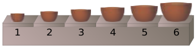
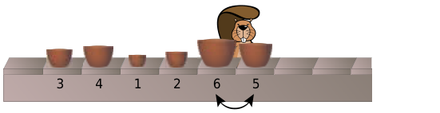
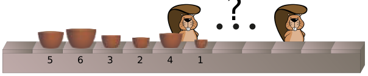

In einer Fabrik werden Schüssel-Sets gefertigt, die aus 6 Schüsseln unterschiedlicher Größe bestehen. Die Produktionsmaschine stellt die Schüsseln eines Sets direkt hintereinander auf ein Fließband, jedoch in beliebiger Reihenfolge. Ein Set muss zum Verpacken aber sortiert sein. Die Schüsseln müssen also in dieser Reihenfolge auf dem Band stehen:

Einige Arbeiter werden ans Fließband gestellt, um die Sets zu sortieren, also in die richtige Reihenfolge zu bringen. Jeder einzelne Arbeiter vertauscht zwei nebeneinander stehende Schüsseln, wenn sie die falsche Reihenfolge haben.

**Beispiel:** Dieser Arbeiter vertauscht die Schüsseln der Größe 5 und 6. Später vertauscht er noch 1 mit 4 und danach 1 mit 3. Die Schüsseln stehen dann so auf dem Band: 1, 3, 4, 2, 5, 6.

Ein Schüssel-Set wird so auf das Band gestellt: 5, 6, 3, 2, 4, 1

**Wie viele Arbeiter werden mindestens benötigt, um das Set zu sortieren?**
