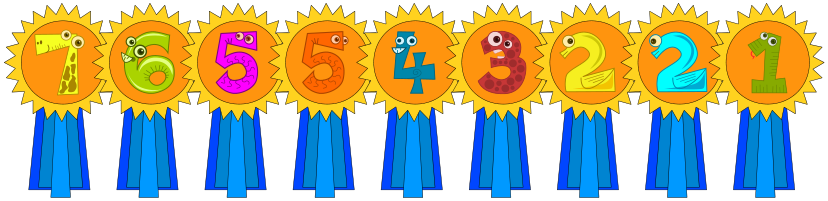

Bei einem Schwimmwettbewerb für Biber und Otter waren neun Teilnehmer dabei. Diese erzielten die folgenden Punktzahlen: 7, 6, 5, 5, 4, 3, 2, 2, 1

Leider waren die Otter nicht besonders erfolgreich: Kein Otter hatte mehr Punkte als irgendein Biber.

Aber: Ein Otter hatte gleich viele Punkte wie ein Biber, und außerdem hatten zwei Otter gleich viele Punkte.

**Wie viele Otter waren beim Wettbewerb dabei?**
