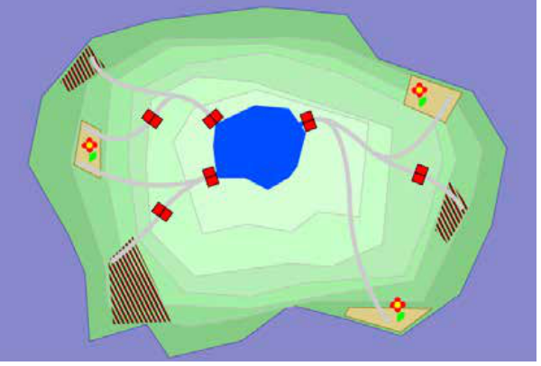

Die Familie Birkenbaum besitzt einen See und darum herum Felder. Durch Kanäle kann Wasser auf die Felder geleitet werden.

Dazu werden die richtigen Wassertore (kleine rote Rechtecke im Bild) geöffnet und geschlossen.

Die Familie Birkenbaum geht sparsam mit dem Wasser ihres Sees um.

- Nur die Blumenfelder (hellbraune Felder mit einer Blume) müssen bewässert werden.
- Die unbepflanzten Felder (braun gestreift) sollen trocken bleiben.

**Hilf der Familie Birkenbaum!** Klicke auf die Wassertore, um nur die Blumenfelder zu bewässern.
