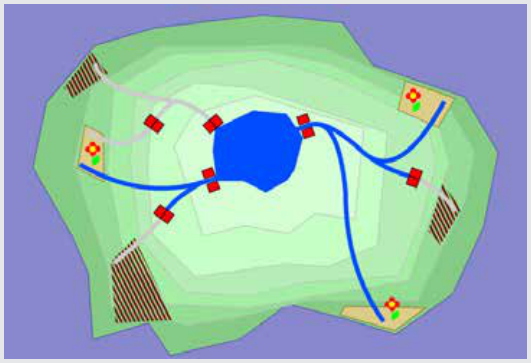

Zwei der drei Wassertore am See müssen geöffnet werden: das Tor rechts am See und das Tor links unten am See. Dann sind die drei Blumenfelder bewässert, und die drei unbepflanzten Felder bleiben trocken.

## Das ist Informatik!

Die Familie Birkenbaum möchte in dieser Biberaufgabe nur bestimmte Felder bewässern. Um das zu lösen, muss man die Karte mit See, Kanälen, Toren und Feldern richtig lesen: Welches Tor lässt Wasser zu welchem Feld fließen? Dabei kann man alles Unwichtige weglassen, etwa die Form der Felder oder die Farbe des Wassers. Übrig bleibt ein Netz aus Orten und Verbindungen dazwischen. So ein Netz nennt man in der Informatik einen Graphen: Die Orte sind die Knoten, die Kanäle sind die Kanten. Dass man ein Problem auf das Wesentliche reduziert und in einer geeigneten Form darstellt, heißt Modellieren.

Im Modell lässt sich eine einfache Frage stellen: Welche Knoten sind von einem Startpunkt aus erreichbar, wenn bestimmte Verbindungen offen oder geschlossen sind? Jedes Tor wirkt dabei wie ein Schalter, der eine Kante freigibt oder sperrt. Die Familie Birkenbaum sucht eine Schalterstellung, bei der alle Blumenfelder erreicht werden und kein unbepflanztes Feld. Auch Entscheidungen, bei denen es so auf eine passende Kombination von Schaltern ankommt, lassen sich auf diese Weise gut durchdenken.

Solche Modelle werden in der Praxis ständig benutzt. Wasserversorger beschreiben ihre Rohrnetze als Graphen und prüfen damit, welche Häuser betroffen sind, wenn ein Ventil geschlossen wird. Stromnetzbetreiber tun dasselbe mit Leitungen und Schaltern, und Verkehrsplanerinnen und Verkehrsplaner mit Straßen, die gesperrt werden.

*Dieser Abschnitt wurde für den Informatik-Otter ergänzt und steht nicht im Biberheft.*
