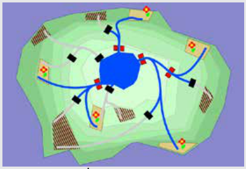

Genau die vier rot dargestellten Wassertore müssen geöffnet werden. Dann sind die fünf Blumenfelder bewässert, und die fünf unbepflanzten Felder bleiben trocken.

## Das ist Informatik!

Bei der Planung von Infrastrukturen gilt es, viele Eventualitäten vorauszusehen.

Bei dieser Biberaufgabe sind es die vernetzten Kanäle und die Positionen der Wassertore, die es dann möglich machen, einen bestimmten Bewässerungsbedarf zu erfüllen. Oder nicht. Andererseits ist Infrastruktur auch teuer, und man möchte nicht zuviel davon aufbauen. Es ist ein guter Kompromiss zwischen notwendiger Mindestausstattung und sinnvoller Reservekapazität zu finden. In der Informatik programmiert man dann ein Simulationssystem und spielt damit viele, vor allem auch extreme Situationen durch. Ob die damit gewonnenen Einsichten aber auch der Realität stand halten, hängt davon ab, wie realistisch das Simulationssystem ist.

Andernfalls gilt das Prinzip GIGO: Garbage in, Garbage out (Müll rein, Müll raus).
