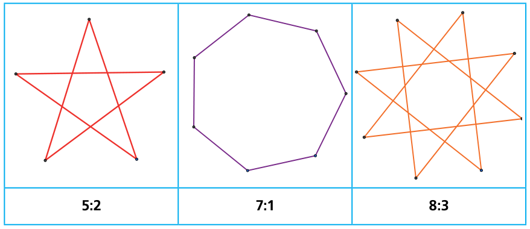
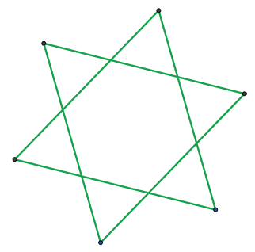

Wie ihr Name schon sagt, liebt Stella Sterne. Sie zeichnet Sterne nach einem besonderen System. Sie beschreibt jeden Stern mit nur zwei Zahlen, z. B. „5:2“.

Die erste Zahl gibt die Anzahl der Spitzen an. Die zweite Zahl legt fest, ob Verbindungslinien immer zur nächsten Spitze gezeichnet werden (dann ist es eine 1) oder zur zweitnächsten (dann ist es eine 2) usw.

Hier siehst du einige von Stellas Sternen:

Wie würde Stella diesen Stern beschreiben?

**Welche Beschreibung gehört zu diesem Stern?**
