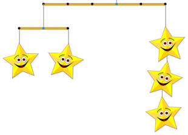

Stern-Mobiles sind kunstvolle Gebilde aus Fäden, Stäben und Sternen. An einem Faden kann eine Anzahl von Sternen hängen; oder ein Stab, an dessen beiden Enden jeweils wieder ein Stern-Mobile hängt.

Das Bild zeigt ein einfaches Stern-Mobile. Mit Zahlen und Klammern kann man es so beschreiben:

**(-3 (-1 1) (1 1)) (2 3)**

Die Zahlen geben an: entweder die Abstände der Stab-Enden zum Faden, an dem der Stab hängt, oder eine Anzahl an Sternen. Die Klammern geben die Struktur des Stern-Mobiles an.

**Welches der folgenden Stern-Mobiles kann man so beschreiben: (-3 (-1 4) (2 (-1 1) (1 1))) (2 (-1 6) (2 3))**
