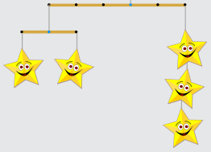

Antwort A ist richtig. Aus dem Beispiel und seiner Beschreibung kann man Folgendes erkennen:

Ein Klammerpaar mit zwei Zahlen (A S) beschreibt einen Faden mit Sternen: A ist der Abstand zum Aufhängefaden des Stabs, an dem der Faden mit Sternen hängt. S ist die Anzahl der Sterne. Der rechte Teil der Beispielbeschreibung (2 3) bedeutet also, dass mit Abstand 2 nach rechts vom Aufhängefaden ein einfaches Stern-Mobile mit 3 Sternen hängt.

Alle anderen Klammerpaare haben drei Bestandteile: (A M1 M2). A gibt wie oben den Abstand zum Aufhängefaden des Stabs an, an dem ein Stern-Mobile aufgehängt ist. M1 und M2 beschreiben die Teil-Mobiles, die am Stab des Stern-Mobiles aufgehängt sind. Der linke Teil der Beispielbeschreibung (-3 (-1 1) (1 1)) bedeutet also, dass mit Abstand 3 vom Aufhängefaden (und zwar nach links, deshalb -3) ein Stern-Mobile hängt, an dessen Stab wiederum zwei einfache Stern-Mobiles hängen. Die Klammerpaare in der Beschreibung eines Stern-Mobiles sind von links nach rechts so angeordnet wie die Teil-Mobiles, die am Stab des Stern-Mobiles hängen.

Die Beschreibung aus der Frage (-3 (-1 4) (2 (-1 1) (1 1))) (2 (-1 6) (2 3)) bedeutet also: Die Teil-Mobiles am obersten Stab hängen links mit Abstand 3 und rechts mit Abstand 2. Am Stab des linken Teil-Mobiles hängt links (Abstand 1) ein Faden mit 4 Sternen und rechts ein Teil-Mobile mit jeweils einem Stern links und rechts (jeweils mit Abstand 1). Am Stab des rechten Teil-Mobiles hängt links (Abstand 1) ein Faden mit 6 Sternen und rechts (Abstand 2) ein Faden mit 3 Sternen. Das ist genau Mobile A.

Bei Mobile B hat das linke Teil-Mobile selbst kein Teil-Mobile. Bei Mobile C gibt es keinen Faden mit 6 Sternen. Bei Mobile D ist alles spiegelverkehrt.

## Das ist Informatik!

Ein Stern-Mobile hat eine interessante Struktur: An jedem Stab hängen nämlich stets wieder (etwas kleinere) Stern-Mobiles. Dabei ist ein Faden mit einem oder mehreren Sternen auch ein (ganz einfaches) Stern-Mobile. Ein Stern-Mobile ist also: entweder (a) ein Faden mit einigen Sternen oder (b) ein Faden mit einem Stab, an dessen Enden je ein Stern-Mobile hängt. Diese Definition benennt Stern-Mobiles als mögliche Bestandteile eines Stern-Mobiles. Strukturen, die kleinere Exemplare des gleichen Strukturtyps als Bestandteil haben, nennt man rekursiv. In der Computerprogrammierung können rekursive Strukturen mit sehr kurzen Programmen bearbeitet werden. Die Programme haben dabei eine ähnlich rekursive Programmstruktur wie die rekursive Definition der Strukturen: Sie bearbeiten entweder den Basisfall (bei den Stern-Mobiles: Faden mit Sternen) oder rufen sich selbst auf, um Teilstrukturen zu bearbeiten, die nicht dem Basisfall entsprechen.
