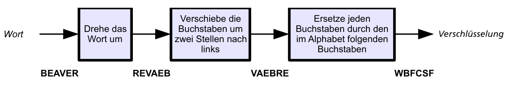

Alex und Betty senden sich verschlüsselte Nachrichten. Dabei verschlüsseln sie jedes Wort einzeln, und zwar in drei Schritten nach folgender Vorschrift:

Aus dem Wort BEAVER (engl. für Biber) ergibt sich die Verschlüsselung WBFCSF.

Betty empfängt diese Verschlüsselung von Alex: **PMGEP**

**Welches Wort hat Alex verschlüsselt?**
