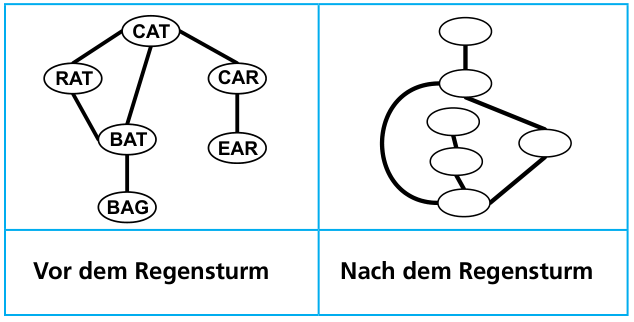

Thomas saß im Garten und schrieb mit einem Filzstift englische Wörter auf Plastikkarten. Er verband die Karten mit Schnüren so: Die Wörter auf zwei verbundenen Plastikkarten unterscheiden sich in genau einem Buchstaben.

Dann ging er ins Haus. Gerade noch rechtzeitig! Denn nun zog ein Regensturm über das Haus.

Als Thomas später zurück in den Garten kam, hatte der Sturm seine Plastikkarten durcheinander gewirbelt und der Regen alle Wörter abgewaschen.

Aber an den Verbindungen konnte Thomas die Plastikkarten wiedererkennen.

**Welche Wörter standen auf welchen Plastikkarten?**
