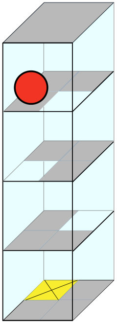

Ein 3D-Labyrinth hat vier Ebenen mit jeweils vier Feldern. Eine Kugel liegt auf der obersten Ebene. Auf der untersten Ebene ist das Ziel: das gelbe Feld.

Du kannst die Kugel mit den Richtungsbefehlen N, O, S und W steuern (Norden ist nach hinten, Osten nach rechts). Auf einem weißen Feld fällt die Kugel eine Ebene nach unten. Das Labyrinth ist geschlossen; du kannst die Kugel also nicht nach außen steuern.

**Steuere die Kugel ins Ziel!**

Gib dazu eine Folge von Richtungsbefehlen ein, zum Beispiel NOS, um die Kugel nach N, O und dann nach S zu bewegen.
